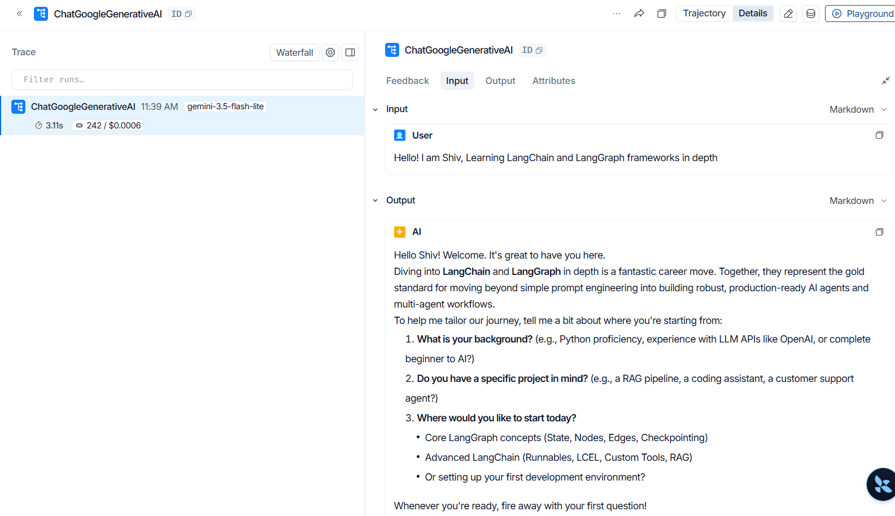

# acme-supportos

A terminal support chatbot for "Acme Cloud". It keeps conversation history, streams tokens, and prints a per-turn and running token/cost meter. The provider is chosen only by the `MODEL` environment variable.

## Setup

1. Install [uv](https://docs.astral.sh/uv/) (Python 3.13+).
2. Install dependencies:
   ```powershell
   uv sync
   ```
3. Create a `.env` file in the repo root (it is gitignored):
   ```
   MODEL=google_genai:gemini-3.5-flash-lite
   GOOGLE_API_KEY=...
   ANTHROPIC_API_KEY=...
   MAX_TOKENS=800
   ```
   `MODEL` uses `provider:model` form. Only the key for the provider you pick is required.

## Run

```powershell
uv run python scripts/chat.py
```

Commands: `/reset` clears history but keeps the system prompt; `exit`/`quit`, Ctrl+C or Ctrl+D ends the session and prints the session total. Ctrl+C during a reply cancels that turn only.

Prices used for the cost estimate live in the `PRICES` dict in `src/acme_supportos/models.py` (USD per 1M tokens). Unknown models are estimated at $0.

## Same conversation, two providers

Only `MODEL` changes; no code changes.

| Provider  | `MODEL`                            |
|-----------|------------------------------------|
| Google    | `google_genai:gemini-3.5-flash-lite` |
| Anthropic | `anthropic:claude-sonnet-4-5`      |

Prompts used: `Hi`, then `How do I reset my Acme Cloud password?`

<!-- TODO: paste the output of each run, including the token/cost line, here. -->

## LangSmith Tracing


